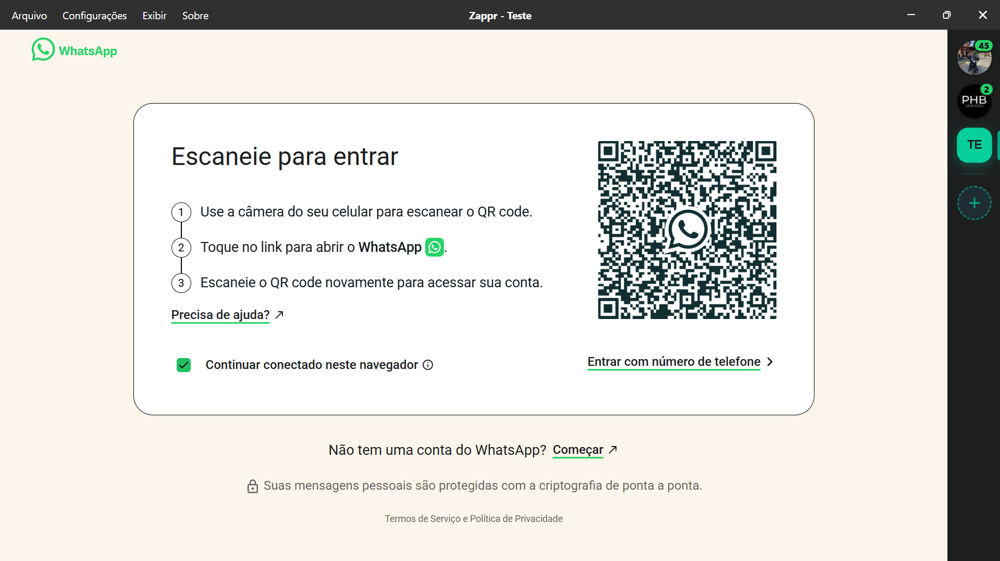
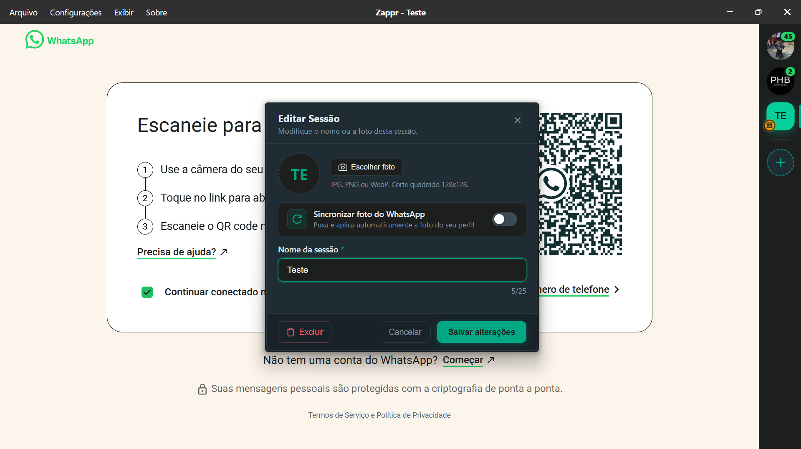
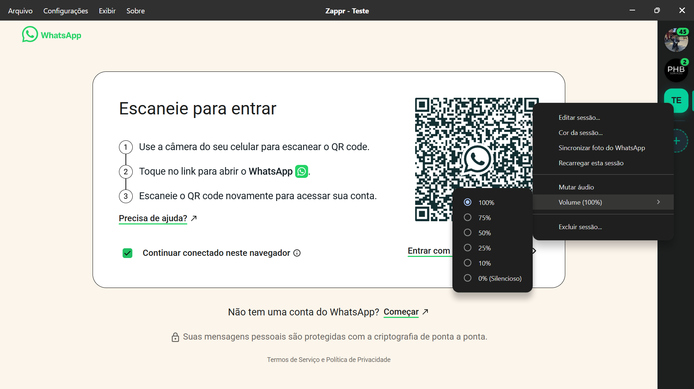
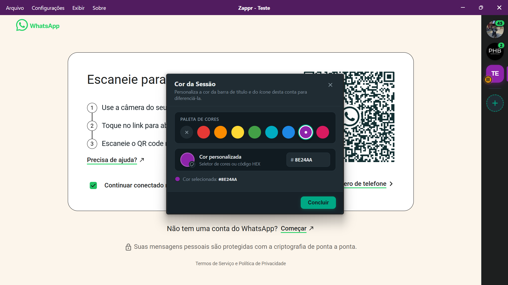
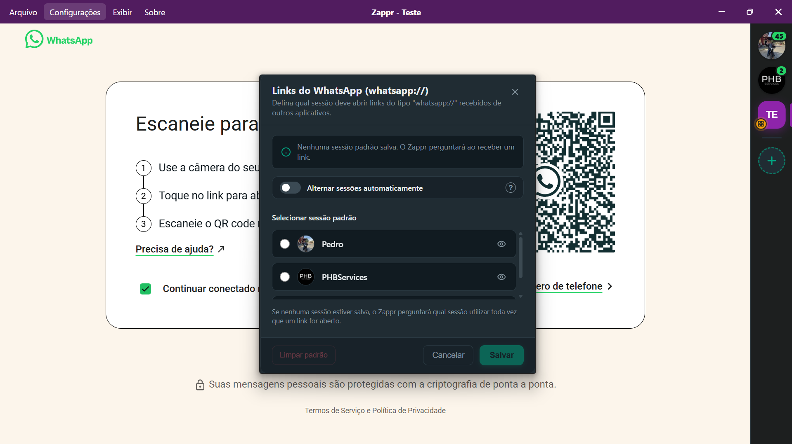
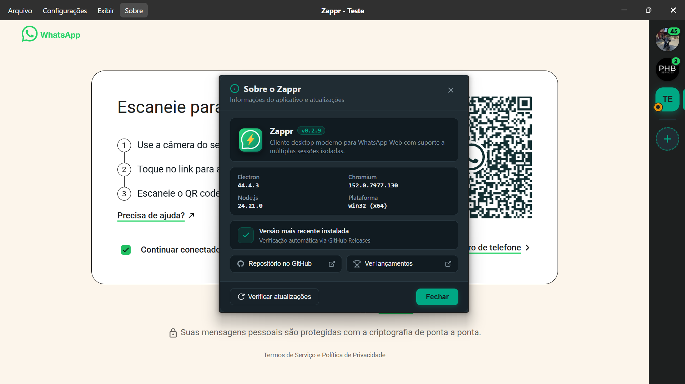

# Zappr ⚡


[English](README.en.md) · [Español](README.es.md) · **Português (Brasil)**

Cliente desktop moderno e de alta performance para WhatsApp Web construído em Electron para **Linux** e **Windows**, com suporte nativo a chamadas de voz e vídeo, compartilhamento de tela, múltiplas contas isoladas em abas com barra lateral estilo Discord, distribuição inteligente de links `whatsapp://`, controle granular de áudio por sessão e badges de mensagens não lidas em tempo real.

<p align="center">
  
</p>

---

## ✨ Recursos em Destaque

### 👥 Múltiplas Contas Isoladas em Abas

- **Barra lateral estilo Discord**: Gerencie contas ilimitadas do WhatsApp simultaneamente em uma única janela elegante.
- **Isolamento total de sessão**: Cada aba opera em uma partição isolada do Electron (`persist:partition`), mantendo dados, logins e cookies 100% segregados e seguros.
- **Reorganização por Arrastar e Soltar (Drag & Drop)**: Reordene facilmente suas contas na barra lateral arrastando os ícones para cima ou para baixo com indicador visual verde e animação fluida.
- **Sincronização de Foto do Perfil do WhatsApp**: Puxe e aplique automaticamente a foto oficial do seu perfil do WhatsApp com um clique no modal de edição ou diretamente pelo menu de contexto de clique direito da aba.
- **Indicador de Status (Aguardando QR Code)**: Badge âmbar pulsante na barra lateral indicando em tempo real quando uma sessão estiver desconectada ou aguardando leitura do código QR.
- **Recarregar Sessão Individual**: Recarregue uma aba específica pelo menu de clique direito sem precisar reiniciar ou afetar as demais conexões.
- **Identificação visual rápida**: Personalize o avatar de cada sessão com fotos customizadas (corte quadrado e compressão automática em WebP) ou iniciais dinâmicas de alto contraste.
- **Alternância ultrarrápida**: Troca instantânea de abas gerenciada via `WebContentsView`, mantendo o consumo de memória baixo e todas as conexões de chat ativas em segundo plano.

### 🔴 Badges de Mensagens Não Lidas em Tempo Real

- **Contador individual por sessão**: Cada ícone na barra lateral exibe um badge flutuante com a contagem exata de conversas não lidas, extraído diretamente da interface do WhatsApp Web.
- **Animação fluida de pop**: Efeito _bounce_ quando novas mensagens chegam para chamar sua atenção discretamente.
- **Sincronização global**: Integração com a contagem da barra de tarefas/dock do sistema operacional.

### 💾 Backup e Restauração de Configurações

- **Exportação e Importação com um clique**: Salve a ordem das suas sessões, apelidos de perfil, fotos, cores e preferências de distribuição de links em um arquivo `.json` portátil através do menu **Configurações > Exportar/Importar**.
- **Migração simplificada**: Transfira facilmente suas configurações personalizadas entre diferentes computadores ou restaure backups rapidamente.

### 🔀 Distribuição Inteligente de Links (`whatsapp://` e `wa.me`)

- **Manipulador nativo de protocolo**: O Zappr registra-se automaticamente no Linux e Windows para interceptar links `whatsapp://` e URLs `wa.me`.
- **Roteamento automático para a sessão ociosa há mais tempo**: Ative a opção de envio automático para distribuir mensagens recebidas em rotação inteligente (_round-robin_), direcionando o lead ou contato para a sessão que não atendeu links recentemente.
- **Envio automático com contagem regressiva**: Pré-visualize e edite a mensagem no modal antes do envio ou ative o envio automático instantâneo com barra de contagem regressiva e botão de cancelamento rápido.
- **Seletor moderno com atalhos de teclado**:
  - Selecione a sessão digitando o número correspondente (`1` a `6`).
  - Navegue com as setas do teclado e confirme com `Enter` ou dê um duplo clique no card.
  - Oculte sessões específicas do seletor para evitar envios acidentais em contas pessoais.

### 🔊 Controle de Áudio Granular por Sessão

- **Ajuste individual de volume**: Defina o volume de notificações de cada conta independentemente (**100%**, **75%**, **50%**, **25%**, **10%** ou **Mudo**).
- **Mudo rápido com um clique**: Silencie qualquer sessão instantaneamente pelo menu de clique direito.
- **Indicador visual de silêncio**: Um badge de alto-falante cortado é exibido sobre a foto da sessão quando ela estiver mutada, evitando surpresas.

### 🎨 Personalização de Cores e Temas

- **Cores independentes**: Atribua uma cor exclusiva para cada conta através do seletor de cores nativo (com suporte a qualquer código HEX ou paleta predefinida).
- **Barra de título dinâmica**: A barra superior sincroniza a sua tonalidade automaticamente com a cor da sessão ativa no momento.
- **Feedback visual completo**: Indicadores laterais (_pill_), bordas e sombras com efeito _glow_ adaptam-se dinamicamente à cor escolhida.

### 🌐 Suporte Multilíngue (Padrão: Português do Brasil)

- O Zappr vem configurado por padrão em **Português do Brasil (`pt-BR`)**, contando também com suporte completo a **Inglês (`en`)** e **Espanhol (`es`)**.
- Troque o idioma a qualquer instante pelo menu **Arquivo > Idioma** sem necessidade de reiniciar.

### 🔄 Atualizações Automáticas e Modal Sobre

- **Verificador de Atualizações Integrado**: Verifique se há novas versões disponíveis diretamente na janela Sobre o Zappr, com barra de progresso de download e notas de versão integradas via GitHub Releases.

### 💬 Navegação e Links Externos Seguros

- Links compartilhados nas conversas (Zoom, Google Meet, YouTube, links externos) abrem automaticamente no navegador padrão do seu sistema operacional, preservando a integridade da janela do WhatsApp.
- Menu de contexto nativo com atalho para copiar links.

---

## 📸 Capturas de Tela

|                            Interface Principal & Múltiplas Contas                            |                         Edição de Sessão & Foto do WhatsApp                         |
| :------------------------------------------------------------------------------------------: | :---------------------------------------------------------------------------------: |
|        |        |
|                          **Controle Granular de Volume por Sessão**                          |                    **Personalização de Cores & Barra Dinâmica**                     |
|  |  |
|                     **Distribuição Inteligente de Links (whatsapp://)**                      |                   **Sobre o Zappr & Verificador de Atualizações**                   |
|            |           |

---

## ⌨️ Atalhos de Teclado

| Atalho                          | Ação                                                            |
| :------------------------------ | :-------------------------------------------------------------- |
| `Ctrl + 1` até `Ctrl + 9`       | Alternar diretamente para a sessão correspondente               |
| `Ctrl + N`                      | Adicionar uma nova sessão do WhatsApp                           |
| `Ctrl + R` / `F5`               | Recarregar a sessão ativa                                       |
| `Ctrl + Shift + R`              | Forçar recarga da sessão ativa (limpando cache de renderização) |
| `Ctrl + +` / `Ctrl + -`         | Aumentar ou diminuir o zoom                                     |
| `Ctrl + 0`                      | Restaurar zoom padrão (100%)                                    |
| `F11`                           | Alternar tela cheia                                             |
| `1` a `9` _(no modal de links)_ | Escolher a sessão para abrir o link                             |
| `Enter` _(no modal de links)_   | Confirmar abertura do link na sessão selecionada                |
| `Esc`                           | Fechar modais e janelas secundárias                             |

---

## 🚀 Instalação

Baixe a versão mais recente diretamente na aba de [Releases](https://github.com/pedruhb/Zappr/releases):

### Linux (Ubuntu / Debian / Mint)

Baixe o arquivo `.deb` e instale via terminal ou instalador gráfico:

```bash
sudo apt install ./zappr_<versao>_amd64.deb
```

### Linux (Qualquer distribuição via AppImage)

Baixe o `.AppImage`, conceda permissão de execução e execute:

```bash
chmod +x Zappr-*.AppImage
./Zappr-*.AppImage
```

> O AppImage inclui atualizações automáticas silenciosas em segundo plano via `electron-updater`.

### Windows

Baixe o executável de instalação ou o pacote portátil disponível na página de lançamentos e execute diretamente.

---

## 🛠️ Desenvolvimento e Contribuição

Requisitos: **Node.js 20+** e **npm**.

```bash
# 1. Clone o repositório
git clone https://github.com/pedruhb/Zappr.git
cd Zappr

# 2. Instale as dependências
npm install

# 3. Inicie o servidor de desenvolvimento com hot-reload
npm run dev

# 4. Executar diretamente com Electron
npm start

# 5. Executar verificação de lint
npm run lint

# 6. Formatar o código
npm run format

# 7. Gerar pacote de distribuição
npm run dist
```

---

## 📄 Licença

Distribuído sob a licença **MIT**. Consulte o arquivo [LICENSE](LICENSE) para mais informações.

_Agradecimento especial aos contribuidores originais do projeto TuxChat pelo excelente alicerce de código._
